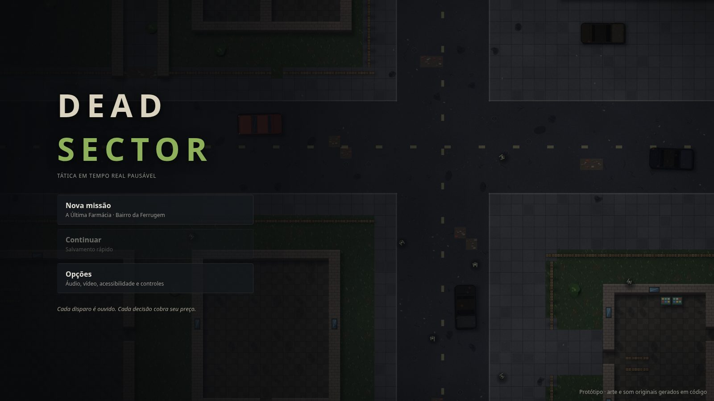
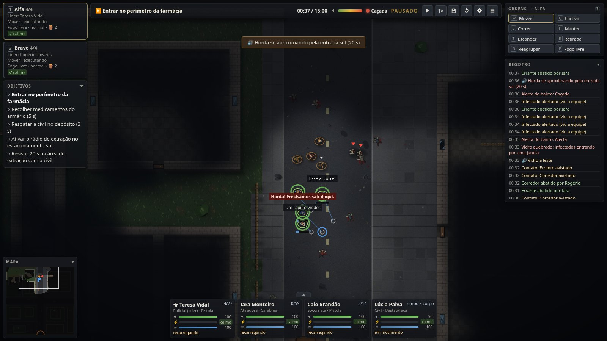
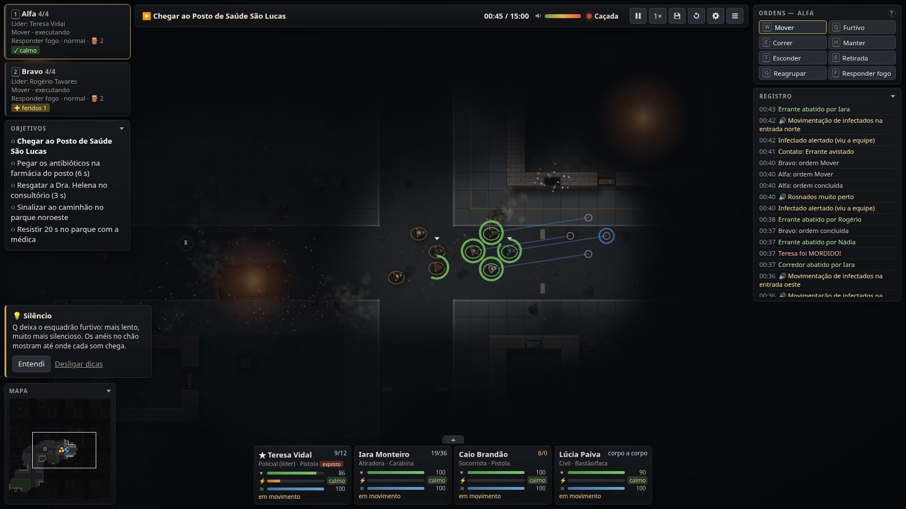
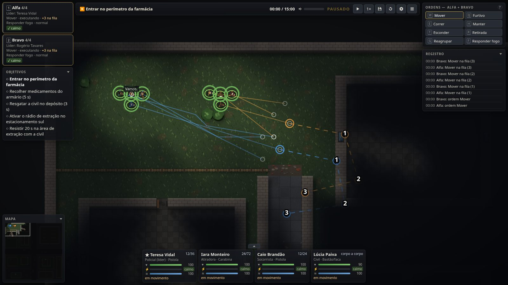
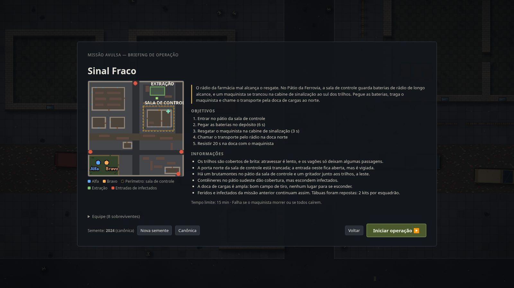
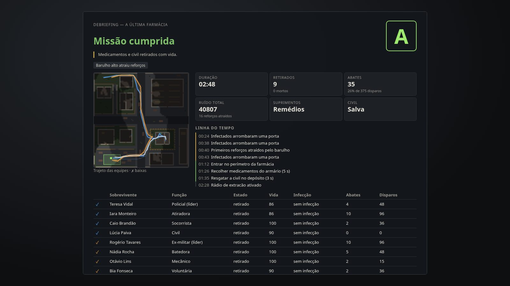

<p align="center">
  
</p>

<h1 align="center">Dead Sector</h1>

<p align="center"><strong>Every shot is heard. Every order has a price.</strong></p>

<p align="center">
  <a href="https://gamestudio42.github.io/dead-sector/"></a>
  <a href="https://github.com/gamestudio42/dead-sector/actions/workflows/pages.yml"></a>
  <a href="https://github.com/gamestudio42/dead-sector/stargazers"></a>
  <a href="https://github.com/gamestudio42"></a>
</p>

<p align="center">
  A pausable real-time squad tactics game in a zombie outbreak, in the browser. You command two
  squads, not soldiers: survivors act on their own under threat, panic and refuse risky orders,
  and the infected react only to what they see and hear. Sound travels through streets, walls and
  doors, so every gunshot can bring the neighbourhood down on you. No installation is needed to play.
</p>

<p align="center">
  <a href="https://gamestudio42.github.io/dead-sector/">
    
  </a>
</p>

<p align="center">
  <a href="https://gamestudio42.github.io/dead-sector/">
    
  </a>
</p>

## Get them out alive

1. **Read the briefing.** Each operation shows the known areas, the entries where infected arrive,
   the objectives and what your squads know about the threat. Pick the route before you move.
2. **Move like you mean it.** Sneak, walk or sprint: speed costs noise and stamina. Close doors to
   muffle sound, hide in bushes, and watch the rings on the ground to see how far each sound carries.
3. **Choose when to fight.** Fire discipline decides who shoots and when. Every shot raises the
   neighbourhood's alarm, brings runners and, at the top, a roaming horde through the avenues.
4. **Keep the squad together.** Stress, wounds and lost leaders break people. A panicking survivor
   stops following orders; a bitten one will turn in minutes unless a medic buys time.
5. **Carry the losses.** In the campaign the dead never come back, and wounds, infection and ammo
   follow your survivors into the next operation.

The simulation is deterministic: the same seed and orders always play out the same way, so saves,
replays and the scripted acceptance runs are exact.

## See the sector

<p align="center">
  
</p>

<table>
<tr>
<td align="center" width="50%" valign="top">
<br>
Plantão Noturno: the Centro Velho at night, lit by lanterns and gunfire.
</td>
<td align="center" width="50%" valign="top">
<br>
Plan ahead: queued waypoints for both squads and the order menu.
</td>
</tr>
<tr>
<td align="center" width="50%" valign="top">
<br>
Every operation starts with a map, objectives and intel.
</td>
<td align="center" width="50%" valign="top">
<br>
The debriefing grades the run and maps every route and loss.
</td>
</tr>
</table>

## Play

Open **[gamestudio42.github.io/dead-sector](https://gamestudio42.github.io/dead-sector/)**. Choose
**Campanha** for the three linked operations of Setor Ferrugem (losses are permanent), or
**Missão avulsa** to play any of them on its own. The interface is in Portuguese; contextual hints
explain each mechanic the first time it matters.

| Action                          | Shortcut                                                 |
| ------------------------------- | -------------------------------------------------------- |
| Select squads                   | left click, drag a box, `1` `2` (`Shift` adds)           |
| Move / attack / interact        | right click on the ground, an infected, a door or object |
| Queue a waypoint / order menu   | `Shift` + right click / `Ctrl` + right click             |
| Sneak / walk / sprint           | `Q` / `W` / `E`                                          |
| Hold / hide / retreat / regroup | `H` / `T` / `R` / `G`                                    |
| Fire discipline                 | `F` (return fire → weapons free → hold fire)             |
| Barricade the door under cursor | `B`                                                      |
| Pause / speed                   | `Space` / `Tab`                                          |
| Quick save / load               | `F5` / `F9`                                              |
| Camera                          | arrows, mouse wheel, middle drag, minimap                |
| Menu / sound                    | `Esc` / `M`                                              |

Every key can be rebound in Opções → Controles. Games and the campaign save in the browser. In
Chrome or Edge the game can be installed as an app that runs full screen and offline.

## Develop

Requires Node.js 22+ and pnpm 10.

```sh
pnpm install
pnpm dev        # http://localhost:5173  (?debug=1 shows sight, sound and AI state)
```

| Command        | Purpose                                                                   |
| -------------- | ------------------------------------------------------------------------- |
| `pnpm check`   | Type check, lint, unit, simulation and acceptance tests, production build |
| `pnpm e2e`     | Playwright browser tests (serves the build on port 4317)                  |
| `pnpm balance` | Plays every scripted route on ten seeds and writes the balance report     |
| `pnpm build`   | Static build in `apps/web/dist`, relative paths, runs from any folder     |

Every push to `main` runs the checks and publishes `apps/web/dist` to GitHub Pages. First
Playwright run: `pnpm --filter @dead-sector/game exec playwright install chromium`.

The simulation is a pure TypeScript package with fixed 100 ms ticks and a seeded RNG; it never
touches Phaser, the DOM or the clock. The Phaser view and the HTML interface only send commands and
read state. See the [project status](docs/STATUS.md), [architecture](docs/architecture/overview.md),
[mission design](docs/game-design/a-ultima-farmacia.md), [specification](docs/SPECIFICATION.md),
[decisions](docs/decisions/), [balance report](docs/testing/balance.md), [asset register](ASSETS.md),
[tasks](TASKS.md) and the [rules for agents](AGENTS.md).

## Licence

Dead Sector is free software under the GNU Affero General Public License, version 3 or any later
version ([`AGPL-3.0-or-later`](LICENSE)), following the
[Game Studio 42](https://github.com/gamestudio42) default for complete games. If you run a modified
version for other people, including as a website or over a network, you must offer them its source
under the same licence. Copyright (c) 2026 Marcel Savegnago.

Its code, maps, missions, rules, procedural art and synthesized sound are original. The game is
mechanically inspired by classic squad-tactics games; no code, maps, interface or assets were
copied. Every asset is listed in the [asset register](ASSETS.md). See [LICENSE](LICENSE) and
[AGENTS.md](AGENTS.md) for project rules.
